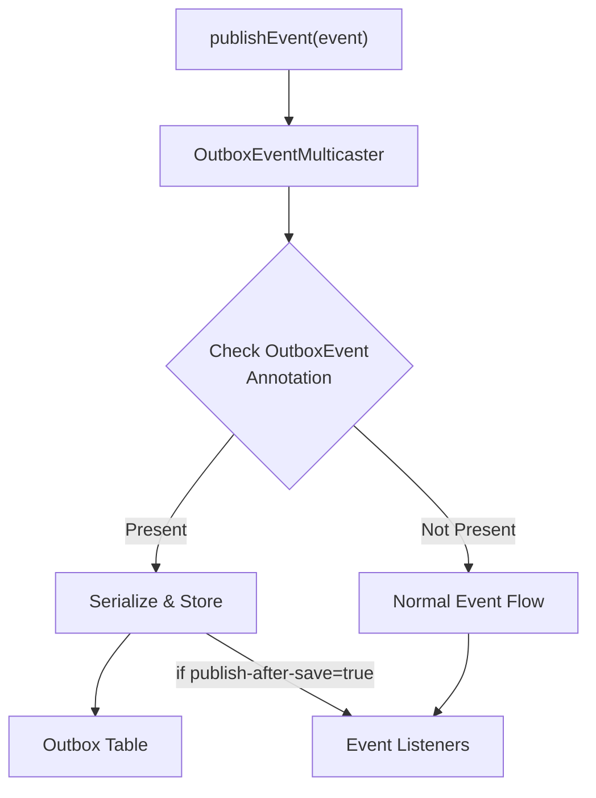

import Tabs from '@theme/Tabs';
import TabItem from '@theme/TabItem';

# Record Scheduling

## Outbox Service API

Schedule records for processing via the `Outbox` service:

Every `schedule()` overload requires an active Spring-managed transaction on the calling thread.
Calls without one throw `IllegalStateException` before collecting context or persisting records.
Place both the business write and scheduling call inside a proxied `@Transactional` method or a
`TransactionTemplate` callback. Calling a `@Transactional` method from another method on the same
instance does not activate Spring's transaction proxy.

With multiple transaction managers, select the one that manages the outbox's database and your
business data. The active-transaction check does not verify that both use the same resource.

<Tabs>
<TabItem value="kotlin" label="Kotlin">

```kotlin
@Service
class OrderService(
    private val outbox: Outbox,
    private val orderRepository: OrderRepository
) {
    @Transactional
    fun createOrder(command: CreateOrderCommand) {
        val order = Order.create(command)
        orderRepository.save(order)
        // Schedule record with explicit key
        outbox.schedule(
            payload = OrderCreatedRecord(order.id, order.customerId),
            key = "order-${order.id}"  // Groups records for ordered processing
        )
    }
    @Transactional
    fun updateOrder(orderId: String) {
        // Schedule record with auto-generated UUID key
        outbox.schedule(payload = OrderUpdatedRecord(orderId))
    }
}
```

</TabItem>
<TabItem value="java" label="Java">

```java
@Service
public class OrderService {
    private final Outbox outbox;
    private final OrderRepository orderRepository;

    public OrderService(Outbox outbox, OrderRepository orderRepository) {
        this.outbox = outbox;
        this.orderRepository = orderRepository;
    }

    @Transactional
    public void createOrder(CreateOrderCommand command) {
        Order order = Order.create(command);
        orderRepository.save(order);
        // Schedule record with explicit key
        outbox.schedule(
            new OrderCreatedRecord(order.getId(), order.getCustomerId()),
            "order-" + order.getId()  // Groups records for ordered processing
        );
    }
    @Transactional
    public void updateOrder(String orderId) {
        // Schedule record with auto-generated UUID key
        outbox.schedule(new OrderUpdatedRecord(orderId));
    }
}
```

</TabItem>
</Tabs>

### Record Lifecycle

Records go through the following states:

- **NEW**: Freshly scheduled, waiting for processing
- **COMPLETED**: Successfully processed by all handlers
- **FAILED**: Exhausted all retries, requires manual intervention

### Record Priority

Every record carries a `priority` (default `0`). Polling selects record keys with the highest
priority first; keys of equal priority are selected by the age of their oldest pending record.
Priority never reorders records of the same key: a record still waits for older records of its key.

Assign priorities with `OutboxPriorityProvider` beans. A provider is invoked in the scheduling
thread, so it can decide by payload or by thread-scoped state. This also reaches records scheduled
by integrations such as Spring Modulith. Providers are consulted in order and the first non-null
value wins.

<Tabs>
<TabItem value="kotlin" label="Kotlin">

```kotlin
@Component
class ReplayPriorityProvider(
    private val replay: ReplayScope,
) : OutboxPriorityProvider {
    override fun provide(payload: Any): Int? = if (replay.isActive()) -1 else null
}
```

</TabItem>
<TabItem value="java" label="Java">

```java
@Component
public class ReplayPriorityProvider implements OutboxPriorityProvider {
    private final ReplayScope replay;

    public ReplayPriorityProvider(ReplayScope replay) {
        this.replay = replay;
    }

    @Override
    public Integer provide(Object payload) {
        return replay.isActive() ? -1 : null;
    }
}
```

</TabItem>
</Tabs>

A lower priority for bulk work (a replay, a backfill) keeps interactive records from waiting behind
its backlog. Low-priority keys are still selected whenever a polling batch has free slots.

---

## OutboxEventMulticaster

The `OutboxEventMulticaster` provides seamless integration with Spring's event system. It automatically intercepts and persists events annotated with `@OutboxEvent` directly to the outbox table, allowing you to use Spring's native `ApplicationEventPublisher` while getting outbox benefits.

### How It Works



### @OutboxEvent Annotation

Mark your events with `@OutboxEvent` to enable automatic outbox persistence:

<Tabs>
<TabItem value="kotlin" label="Kotlin">

```kotlin
@OutboxEvent(key = "#this.orderId")  // SpEL expression for key resolution
data class OrderCreatedEvent(
    val orderId: String,
    val customerId: String,
    val amount: BigDecimal
)
```

</TabItem>
<TabItem value="java" label="Java">

```java
@OutboxEvent(key = "#this.orderId")  // SpEL expression for key resolution
public class OrderCreatedEvent {
    private String orderId;
    private String customerId;
    private BigDecimal amount;
    // constructor, getters, setters...
}
```

</TabItem>
</Tabs>

#### SpEL Key Resolution

The `key` parameter supports Spring Expression Language (SpEL) for dynamic key extraction:

| Expression           | Description                        | Example               |
|----------------------|------------------------------------|-----------------------|
| `#root.fieldName`    | Access root object property        | `#root.orderId`       |
| `fieldName`          | Access root object property        | `customerId`          |
| `#root.getId()`      | Call method on root object         | `#root.getOrderId()`  |
| `#root.nested.field` | Access nested properties           | `#root.order.id`      |
| `#root.toString()`   | Convert to string                  | `#root.id.toString()` |

<Tabs>
<TabItem value="simple" label="Simple Property">

```kotlin
@OutboxEvent(key = "#this.orderId")
data class OrderEvent(val orderId: String)
```

</TabItem>
<TabItem value="method" label="Method Call">

```kotlin
@OutboxEvent(key = "#this.getAggregateId()")
data class DomainEvent(val id: UUID) {
    fun getAggregateId() = id.toString()
}
```

</TabItem>
<TabItem value="nested" label="Nested Property">

```kotlin
@OutboxEvent(key = "#this.order.id")
data class OrderConfirmedEvent(val order: Order)
```

</TabItem>
</Tabs>

### Configuration

The multicaster can be configured to control event publishing behavior:

```yaml
namastack:
  outbox:
    multicaster:
      enabled: true  # Enable/disable automatic interception (default: true)
      publish-after-save: true  # Also forward to other listeners in same transaction (default: true)
```

| Configuration         | Value            | Effect                                                       |
|-----------------------|------------------|--------------------------------------------------------------|
| `multicaster.enabled` | `true` (default) | @OutboxEvent annotations are intercepted and stored          |
| `multicaster.enabled` | `false`          | OutboxEventMulticaster is disabled, events flow normally     |
| `publish-after-save`  | `true` (default) | Events also published to other listeners in same transaction |
| `publish-after-save`  | `false`          | Events only stored to outbox, not published to listeners     |

### Usage Example

<Tabs>
<TabItem value="kotlin" label="Kotlin">

```kotlin
@Service
class OrderService(
    private val orderRepository: OrderRepository,
    private val eventPublisher: ApplicationEventPublisher
) {
    @Transactional
    fun createOrder(command: CreateOrderCommand) {
        val order = Order.create(command)
        orderRepository.save(order)
        // Automatically saved to outbox + published to listeners
        eventPublisher.publishEvent(
            OrderCreatedEvent(order.id, order.customerId, order.amount)
        )
    }
}
```

</TabItem>
<TabItem value="java" label="Java">

```java
@Service
public class OrderService {
    private final OrderRepository orderRepository;
    private final ApplicationEventPublisher eventPublisher;

    public OrderService(OrderRepository orderRepository, 
                       ApplicationEventPublisher eventPublisher) {
        this.orderRepository = orderRepository;
        this.eventPublisher = eventPublisher;
    }

    @Transactional
    public void createOrder(CreateOrderCommand command) {
        Order order = Order.create(command);
        orderRepository.save(order);
        // Automatically saved to outbox + published to listeners
        eventPublisher.publishEvent(
            new OrderCreatedEvent(order.getId(), order.getCustomerId(), order.getAmount())
        );
    }
}
```

</TabItem>
</Tabs>

### @OutboxEvent with Context

When using `@OutboxEvent` with `ApplicationEventPublisher`, you can define context using SpEL expressions:

<Tabs>
<TabItem value="kotlin" label="Kotlin">

```kotlin
@OutboxEvent(
    key = "#this.orderId",
    context = [
        OutboxContextEntry(key = "customerId", value = "#this.customerId"),
        OutboxContextEntry(key = "region", value = "#this.region"),
        OutboxContextEntry(key = "priority", value = "#this.priority")
    ]
)
data class OrderCreatedEvent(
    val orderId: String,
    val customerId: String,
    val region: String,
    val priority: String
)
```

</TabItem>
<TabItem value="java" label="Java">

```java
@OutboxEvent(
    key = "#this.orderId",
    context = {
        @OutboxContextEntry(key = "customerId", value = "#this.customerId"),
        @OutboxContextEntry(key = "region", value = "#this.region"),
        @OutboxContextEntry(key = "priority", value = "#this.priority")
    }
)
public class OrderCreatedEvent {
    private String orderId;
    private String customerId;
    private String region;
    private String priority;
    // constructor, getters...
}
```

</TabItem>
</Tabs>

Context from `@OutboxEvent` annotations is merged with context from registered `OutboxContextProvider` beans.
